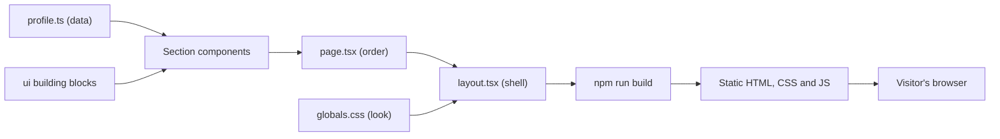

# How this website works: a beginner's tutorial

This tutorial walks through the personal website in this folder: what it is made of, how the pieces fit together, and what each file does. It assumes no prior frontend or backend experience. Where a term is new, it is explained the first time it appears, and there is a glossary at the end.

It is organised in five parts:

1. [What was built](#1-what-was-built)
2. [Technology summary](#2-technology-summary)
3. [High-level walkthrough](#3-high-level-walkthrough)
4. [Detailed code review](#4-detailed-code-review)
5. [Five ways the code can be improved](#5-five-ways-the-code-can-be-improved)

You already work with pipelines, so one analogy runs through the tutorial: **the site is a small pipeline**. One file holds the data (`profile.ts`), a set of functions transform that data into HTML (the components), and a build step materialises the result so it can be served quickly.

---

## 1. What was built

A single-page website at `http://localhost:3000` that presents your CV. From top to bottom the page has:

| Section | What it shows |
| --- | --- |
| Navigation bar | Links that jump to each section, plus a thin progress line that grows as you scroll |
| Hero | Your name in a very large headline, your title, a one-line pitch and a small "pipeline run" panel |
| About | Three paragraphs, focus areas, languages and location |
| Impact | Four headline figures; three of them count up from zero when they scroll into view |
| Career journey | A vertical timeline of seven roles and recognitions; the line fills in as you scroll |
| Stack and skills | Tools grouped by type, and five core disciplines |
| Credentials | Three certificates and your degree |
| Portfolio | Three "coming soon" cards that turn into links when you add a URL |
| Contact | A link to your LinkedIn profile |

### Frontend and backend: what this project has of each

**Frontend** is the code that runs in the visitor's browser: what they see and interact with. **Backend** is the code that runs on a server: databases, logins, APIs, anything the visitor never sees directly.

This project is almost entirely frontend. It has **no database, no API, no login and no form handling**. The `.env` file in the folder is not read by any of the site's code.

There is still a server-side step, and it is worth understanding:

- **At build time**, Next.js runs your components once on your machine and saves the resulting HTML. This is called *prerendering*. The build output confirms it: the `/` route is marked `○ (Static) prerendered as static content`.
- **At request time**, a server simply hands that saved HTML to the browser. Nothing is computed per visitor.

In pipeline terms: the build is a batch job that writes a materialised table, and the server only reads from it.

---

## 2. Technology summary

| Technology | Version in `package.json` | What it is | What it does here |
| --- | --- | --- | --- |
| **HTML** | n/a | The language that describes page structure (headings, paragraphs, links) | The final output the browser receives |
| **CSS** | n/a | The language that describes appearance (colour, size, layout) | All visual styling |
| **JavaScript** | n/a | The programming language browsers run | Animations, the mobile menu, scroll tracking |
| **TypeScript** | `^5` | JavaScript plus type annotations, checked before the code runs | Catches mistakes such as a missing field on a role |
| **React** | `^19.3.1` | A library for building a page out of reusable functions called *components* | Every section is a component |
| **Next.js** | `16.4.6` | A framework built on React that adds routing, a build step, a development server and font and metadata handling | The backbone of the project |
| **Tailwind CSS** | `4.3.3` | A styling system where you write small class names such as `text-accent` directly on elements | Almost all styling |
| **Motion** | `^14.14.0` | An animation library for React (imported as `motion/react`) | The count-up, the timeline fill, the nav progress line |
| **Playwright** | `^1.65.1` | A tool that drives a real browser from a script | The automated tests in `tests/` |
| **ESLint** | `^9` | A tool that scans code for likely mistakes ("linting") | `npm run lint` |
| **Node.js and npm** | Node 23 on this machine | Node runs JavaScript outside a browser; npm installs packages and runs scripts | Running the dev server and the build |
| **vinext, Vite, Cloudflare Workers** | `vinext ^1.4.6`, `vite ^8.3.0` | An alternative build path that packages the site to run on Cloudflare's hosting | Deployment only. See [the Cloudflare deployment files](#the-cloudflare-deployment-files) |

Two fonts are loaded from Google Fonts through Next.js: **Inter Tight** for text and **JetBrains Mono** for the small monospace labels.

### Commands you will use

Run these in a terminal from the project folder.

| Command | What it does |
| --- | --- |
| `npm install` | Downloads every package listed in `package.json` into `node_modules/`. Needed once, and again whenever dependencies change |
| `npm run dev` | Starts the development server at `http://localhost:3000`. The page reloads automatically when you save a file |
| `npm run build` | Type-checks the code and produces the optimised production version in `.next/` |
| `npm run start` | Serves the production version created by `npm run build` |
| `npm run lint` | Runs ESLint over the project |
| `npm test` | Runs the browser tests in `tests/`. It uses the dev server if one is running and starts one if not |

---

## 3. High-level walkthrough

### 3.1 The folder map

```text
next-js-site/
├── src/
│   ├── content/
│   │   └── profile.ts          ← ALL the text and data on the site
│   ├── app/
│   │   ├── layout.tsx          ← the outer HTML shell: fonts, page title
│   │   ├── page.tsx            ← the home page: lists the sections in order
│   │   ├── globals.css         ← colours, fonts, background, shared styles
│   │   └── favicon.ico         ← the small icon in the browser tab
│   └── components/
│       ├── Nav.tsx             ← navigation bar and mobile menu
│       ├── Hero.tsx            ← big name, tagline, pipeline panel
│       ├── About.tsx
│       ├── Impact.tsx          ← the four headline numbers
│       ├── Journey.tsx         ← the career timeline
│       ├── Stack.tsx
│       ├── Credentials.tsx
│       ├── Portfolio.tsx
│       ├── Contact.tsx         ← contact section and footer
│       ├── Providers.tsx       ← app-wide animation setting
│       └── ui/                 ← small building blocks reused by sections
│           ├── Reveal.tsx      ← fade-in-on-scroll wrapper
│           ├── CountUp.tsx     ← animated number
│           ├── SectionHeading.tsx
│           └── Icons.tsx       ← three small arrow and tick icons
├── tests/
│   └── site.spec.ts            ← automated browser tests
├── playwright.config.ts        ← settings for those tests
├── package.json                ← dependencies and scripts
├── next.config.ts              ← Next.js settings
├── tsconfig.json               ← TypeScript settings
├── eslint.config.mjs           ← ESLint settings
├── vite.config.ts              ┐
├── cloudflare.config.ts        ├ Cloudflare deployment path
├── postcss.config.mjs          ┘
├── .gitignore                  ← files git should never track
├── README.md
└── CV.pdf                      ← your CV (ignored by git)
```

Folders you can ignore because they are generated automatically: `node_modules/` (installed packages), `.next/` (Next.js build output), and `dist/`, `.vinext/`, `.cloudflare/` (Cloudflare build output).

### 3.2 The core idea: data flows one way



Reading left to right:

1. **`profile.ts`** is the only place content lives. Your roles, numbers and links are plain data.
2. **Section components** each read the part of that data they need and return HTML describing how to display it.
3. **`page.tsx`** places the sections in order.
4. **`layout.tsx`** wraps the page in the `<html>` and `<body>` tags and attaches fonts and the page title.
5. **The build** runs all of that once and saves the output.
6. **The browser** receives ready-made HTML, then downloads JavaScript that makes the interactive parts work. That second step, where React attaches behaviour to HTML that already exists, is called *hydration*.

The practical consequence: **when your CV changes, you edit `profile.ts` and nothing else**. What stays in the components is interface wording such as "Coming soon" and "Active".

### 3.3 What a component is

A component is a function that returns markup. Here is the whole home page:

```tsx
export default function Home() {
  return (
    <>
      <Nav />
      <main>
        <Hero />
        <About />
        <Impact />
        <Journey />
        <Stack />
        <Credentials />
        <Portfolio />
        <Contact />
      </main>
      <Footer />
    </>
  );
}
```

The HTML-like syntax inside JavaScript is called **JSX**. `<Hero />` means "call the `Hero` function and put what it returns here". Files that contain JSX end in `.tsx` (TypeScript plus JSX).

### 3.4 Server components and client components

Next.js has two kinds of component:

- **Server components** (the default) run only during the build. They produce HTML and send no JavaScript to the browser. `Hero`, `About`, `Impact`, `Stack`, `Credentials`, `Portfolio` and `Contact` are server components.
- **Client components** also run in the browser, so they can respond to scrolling and clicks. A file becomes a client component by starting with the line `"use client";`. `Nav`, `Journey`, `Reveal`, `CountUp` and `Providers` are client components.

The rule of thumb used here: a component is a client component only if it needs the browser (state, scroll position, animation). Everything else stays on the server so visitors download less JavaScript.

---

## 4. Detailed code review

Files are covered in the order the data flows: content, shell, styles, building blocks, sections, configuration.

### 4.1 `src/content/profile.ts`: the data

The file starts by describing the *shape* of the data with TypeScript types:

```ts
export type Role = {
  id: string;
  org: string;
  title: string;
  /** Display range, e.g. "03/2024 — Present" */
  period: string;
  start: string; // YYYY-MM, used for the compact year label
  current?: boolean;
  kind: "work" | "recognition";
  summary: string;
  highlights: string[];
  tags: string[];
};
```

How to read this:

- `org: string` means every role must have an `org`, and it must be text.
- `current?: boolean` has a question mark, so it is optional.
- `kind: "work" | "recognition"` allows only those two exact values. A typo such as `"recogniton"` fails the build.
- `highlights: string[]` is a list of text values.

If you know SQL, a type is a table schema: column names, data types and which columns are nullable.

Then comes the data itself, one large object:

```ts
export const profile = {
  name: "Avery Chan",
  title: "Senior Data Engineer",
  location: "Hong Kong",
  // ...
  roles: [
    {
      id: "hotmob",
      org: "Hotmob Limited",
      title: "Data Engineer",
      period: "03/2024 — Present",
      start: "2024-03",
      current: true,
      kind: "work",
      // ...
    },
    // six more
  ] satisfies Role[],
};
```

`satisfies Role[]` asks TypeScript to check that every item in the list matches the `Role` type. If you add a role and forget `summary`, `npm run build` stops with an error that names the missing field.

The other lists (`metrics`, `runLog`, `portfolio`, `socials`) are declared above the main object with their type written out, which gives the same checking:

```ts
const portfolio: PortfolioItem[] = [
  { id: "case-studies", title: "Pipeline case studies", /* ... */ },
];
```

Three design choices to notice in this file:

- **Hidden until filled.** `socials` contains GitHub with an empty `href`. The Contact section filters out empty ones, so nothing shows until you add a URL.
- **A metric is one of two shapes.** The `Metric` type says a metric has either a numeric `value` (animated) or a `display` string (static, used for "TB+"). An entry with neither fails the build:

  ```ts
  export type Metric =
    | (MetricBase & { value: number; prefix?: string; suffix?: string })
    | (MetricBase & { display: string });
  ```

  The `|` means "or". This is called a *union type*.
- **Headings are data too.** `sections` holds each section's label, title and intro, and `contact` holds the LinkedIn link, so wording changes never require opening a component.

### 4.2 `src/app/layout.tsx`: the shell

Next.js uses folder and file names as conventions. Inside `src/app/`, a file called `layout.tsx` wraps every page, and `page.tsx` is the page itself. This is called the **App Router**.

**Fonts:**

```tsx
const interTight = Inter_Tight({
  variable: "--font-inter-tight",
  subsets: ["latin"],
  display: "swap",
});
```

`next/font` downloads the font at build time and serves it from your own site, so the visitor's browser makes no request to Google. `variable` exposes the font as a CSS variable that `globals.css` picks up. `display: "swap"` shows text in a fallback font immediately and swaps in the real one when it arrives, instead of showing nothing.

**Metadata:**

```tsx
export const metadata: Metadata = {
  title: `${profile.name} — ${profile.title}`,
  description: profile.description,
  openGraph: {
    title: `${profile.name} — ${profile.title}`,
    description: profile.description,
    type: "website",
  },
};
```

Exporting an object called `metadata` tells Next.js what to put in the page's `<head>`: the browser-tab title, the description search engines show, and the Open Graph tags that social sites read when someone shares the link. The backtick strings are *template literals*: `${...}` inserts a value, so the title becomes "Avery Chan — Senior Data Engineer". Note that it reads from `profile`, so the name is not typed twice.

**The shell itself:**

```tsx
export default function RootLayout({ children }: LayoutProps<"/">) {
  return (
    <html
      lang="en"
      className={`${interTight.variable} ${jetbrains.variable} antialiased`}
      suppressHydrationWarning
    >
      <head>
        <script dangerouslySetInnerHTML={{ __html: revealGuard }} />
      </head>
      <body className="min-h-screen">
        <Providers>{children}</Providers>
      </body>
    </html>
  );
}
```

`children` is whatever page is being displayed. `Providers` is a small client component that wraps the page in Motion's `<MotionConfig reducedMotion="user">`, which tells every Motion animation to respect the visitor's "reduce motion" operating-system setting.

The `<script>` holds one line of JavaScript, `revealGuard`, that runs before anything is drawn. It adds a `data-js` attribute to the `<html>` element, which is the signal the stylesheet uses to know that scripts work in this browser. If the rest of the site's JavaScript has not started five seconds later, it removes the attribute again. [Section 4.5](#45-srccomponentsuirevealtsx-a-reusable-animation-wrapper) explains why. `suppressHydrationWarning` tells React not to complain that the `<html>` element gained an attribute it did not put there.

### 4.3 `src/app/globals.css`: the look

**Design tokens.** The top of the file defines the palette once:

```css
@import "tailwindcss";

@theme inline {
  --color-bg: #07080a;
  --color-surface: #0c0e11;
  --color-line: rgb(236 236 230 / 0.1);
  --color-fg: #ecece6;
  --color-muted: #9a9ea6;
  --color-accent: #c6ff3d;
  --color-accent-ink: #0a0d02;

  --font-sans: var(--font-inter-tight), ui-sans-serif, system-ui, sans-serif;
  --font-mono: var(--font-jetbrains), ui-monospace, SFMono-Regular, monospace;
}
```

In Tailwind 4, the `@theme` block is where you register your own values. Declaring `--color-accent` automatically creates classes such as `text-accent`, `bg-accent` and `border-accent`. To change the lime accent everywhere on the site, you change that one line.

**How to read Tailwind classes.** Throughout the components you will see long `className` strings. Each word is one small style rule:

```tsx
<section id="about" className="py-24 md:py-36">
```

| Class | Meaning |
| --- | --- |
| `py-24` | Padding on the y-axis (top and bottom) of 24 units, which is 6rem |
| `md:py-36` | From the `md` breakpoint (768px wide) upward, use 36 units instead |

The prefixes `sm:`, `md:` and `lg:` mean "at 640px, 768px and 1024px wide and above". Styles without a prefix apply to phones first, and prefixed ones override them on larger screens. This is called *mobile-first* design.

**The background.** Two decorative layers are drawn with *pseudo-elements*, which are extra boxes CSS can create without any HTML:

```css
/* Faint engineering grid that fades toward the edges of the viewport */
body::before {
  content: "";
  position: fixed;
  inset: 0;
  z-index: -2;
  pointer-events: none;
  background-image:
    linear-gradient(to right, rgb(236 236 230 / 0.035) 1px, transparent 1px),
    linear-gradient(to bottom, rgb(236 236 230 / 0.035) 1px, transparent 1px);
  background-size: 72px 72px;
  mask-image: radial-gradient(ellipse 80% 70% at 50% 30%, #000 30%, transparent 85%);
}
```

- `position: fixed; inset: 0` pins the box to all four edges of the window, so it stays put while the page scrolls.
- The two gradients each draw a 1px line and repeat every 72px, one set vertical and one horizontal. Together they form a grid.
- `mask-image` fades the grid out toward the edges.
- `pointer-events: none` lets clicks pass through it.

`body::after` works the same way but draws a faint film-grain texture from a tiny inline SVG image.

**Shared classes.** Three custom classes are used across many components:

```css
.label {
  font-family: var(--font-mono);
  font-size: 0.72rem;
  letter-spacing: 0.14em;
  text-transform: uppercase;
  color: var(--color-dim);
}
```

`.label` is the small uppercase monospace text ("01 / ABOUT"). `.container-x` centres content and caps its width at 1280px. `.outline-text` draws letters as an outline, used for "Chan" in the hero.

**Accessibility rules:**

```css
:focus-visible {
  outline: 2px solid var(--color-accent);
  outline-offset: 3px;
}

@media (prefers-reduced-motion: reduce) {
  *,
  *::before,
  *::after {
    animation-duration: 0.01ms !important;
    transition-duration: 0.01ms !important;
  }
}
```

The first rule gives a visible lime outline to whatever element a keyboard user has tabbed to. The second effectively switches off CSS animations for visitors who have asked their device to reduce motion.

### 4.4 `src/app/page.tsx`: the page

You saw the body of this file in [section 3.3](#33-what-a-component-is). One extra element sits at the top:

```tsx
<a
  href="#about"
  className="sr-only z-[70] bg-accent px-4 py-2 text-accent-ink focus:not-sr-only focus:fixed focus:top-3 focus:left-3"
>
  Skip to content
</a>
```

This is a **skip link**. `sr-only` hides it visually while keeping it available to screen readers. `focus:not-sr-only` makes it appear when a keyboard user presses Tab, so they can jump past the navigation. The `href="#about"` format is an *anchor link*: it scrolls to the element whose `id` is `about`. Every nav link on this site works the same way.

Imports at the top of the file use the `@/` prefix:

```tsx
import { Hero } from "@/components/Hero";
```

`@/` is a shortcut for the `src/` folder, configured in `tsconfig.json`. It avoids fragile relative paths such as `../../components/Hero`.

### 4.5 `src/components/ui/Reveal.tsx`: a reusable animation wrapper

```tsx
"use client";

export function Reveal({ children, delay = 0, className, as: Tag = "div" }: RevealProps) {
  const [node, setNode] = useState<HTMLElement | null>(null);
  const [revealed, setRevealed] = useState(false);

  useEffect(() => {
    if (!node) return;
    const observer = new IntersectionObserver(
      ([entry]) => {
        if (entry.isIntersecting) {
          setRevealed(true);
          observer.disconnect();
        }
      },
      { rootMargin: "0px 0px -10% 0px" },
    );
    observer.observe(node);
    return () => observer.disconnect();
  }, [node]);

  return (
    <Tag
      ref={setNode}
      data-reveal=""
      data-revealed={revealed ? "" : undefined}
      className={className}
      style={{ "--reveal-delay": `${delay}s` } as CSSProperties}
    >
      {children}
    </Tag>
  );
}
```

This is the most reused piece in the project. Anything wrapped in `<Reveal>` fades in and rises 24 pixels the first time it scrolls into view.

- **Props** are the inputs to a component, written like HTML attributes: `<Reveal delay={0.08}>`. `delay = 0` in the function signature sets a default when the prop is not given.
- `children` is whatever is placed between the opening and closing tags.
- `as: Tag = "div"` lets the caller choose the HTML tag, so `<Reveal as="li">` renders a list item.
- `IntersectionObserver` is a browser feature that reports when an element enters the visible area. The `-10%` bottom margin delays the trigger until the element is a little way into the screen. Once it fires, the component stops watching, so the animation plays once.
- The component itself does not animate anything. It only marks the element: `data-reveal` always, and `data-revealed` once it has been seen.

The animation lives in `globals.css`:

```css
html[data-js] [data-reveal]:not([data-revealed]) {
  opacity: 0;
}

html[data-js] [data-reveal][data-revealed] {
  animation: reveal 0.8s cubic-bezier(0.22, 1, 0.36, 1) var(--reveal-delay, 0s) backwards;
}
```

Read the first rule as: "if `<html>` has `data-js`, hide any reveal element that has not been revealed yet". The second plays the fade when the mark appears.

The `html[data-js]` part is what keeps the page safe. The HTML the server sends is fully visible. Content is hidden only in a browser where the small script from `layout.tsx` has run, and that script un-hides everything if the app fails to start. A visitor whose JavaScript is blocked or broken still gets a complete, readable page, without the animation.

Writing this once and reusing it everywhere is the main benefit of components: the fade behaviour is defined in one file, not copied into forty places.

### 4.6 `src/components/ui/CountUp.tsx`: hooks

This component introduces **hooks**, which are special React functions whose names start with `use`. They let a component remember things and react to changes.

```tsx
export function CountUp({ value, prefix = "", suffix = "", className }: CountUpProps) {
  const ref = useRef<HTMLSpanElement>(null);
  const inView = useInView(ref, { once: true, margin: "0px 0px -10% 0px" });
  const reduce = useReducedMotion();

  useEffect(() => {
    const node = ref.current;
    if (!node) return;
    if (reduce) {
      node.textContent = String(value);
      return;
    }
    if (!inView) {
      node.textContent = "0";
      return;
    }
    const controls = animate(0, value, {
      duration: 1.8,
      ease: [0.16, 1, 0.3, 1],
      onUpdate: (v) => {
        node.textContent = String(Math.round(v));
      },
    });
    return () => controls.stop();
  }, [inView, reduce, value]);

  return (
    <span className={className}>
      {prefix}
      <span ref={ref} className="tabular-nums">
        {value}
      </span>
      {suffix}
    </span>
  );
}
```

Step by step:

1. `useRef` creates a handle to a real element on the page. Attaching it with `ref={ref}` lets the code reach that `<span>` directly.
2. `useInView` (from Motion) returns `true` once that element has scrolled into view.
3. `useReducedMotion` returns `true` if the visitor prefers reduced motion.
4. `useEffect` runs code *after* the component appears on screen, and again whenever a value in its dependency list `[inView, reduce, value]` changes.
5. Inside the effect: if reduced motion is on, show the final number at once. If the element is not visible yet, set it to 0 and wait. Otherwise animate a number from 0 to `value` over 1.8 seconds and write each intermediate value into the span.
6. The function returned at the end (`() => controls.stop()`) is a *cleanup*. React calls it if the component is removed mid-animation.

Two deliberate choices. First, the component returns the real number (`{value}`), so the HTML sent by the server reads "80%" and not "0%"; the reset to 0 only happens once JavaScript is running. Second, the number is written straight into the page with `node.textContent` instead of being stored in React state. Updating state would make React re-run the component around sixty times a second; writing the text directly avoids that work.

`tabular-nums` makes every digit the same width, so the number does not jitter sideways as it counts.

### 4.7 `src/components/ui/SectionHeading.tsx`: composition

```tsx
export function SectionHeading({ index, label, title, muted, intro }: SectionHeadingProps) {
  return (
    <header className="mb-14 md:mb-20">
      <Reveal>
        <div className="flex items-center gap-4">
          <span className="label text-accent">{index}</span>
          <span className="label">/ {label}</span>
          <span aria-hidden="true" className="h-px flex-1 bg-line" />
        </div>
      </Reveal>
      <Reveal delay={0.08}>
        <h2 className="mt-8 max-w-4xl text-4xl ... md:text-6xl">
          {title}
          {muted ? <span className="text-muted"> {muted}</span> : null}
        </h2>
      </Reveal>
      {intro ? (
        <Reveal delay={0.16}>
          <p className="mt-6 max-w-2xl text-lg leading-relaxed text-muted text-pretty">{intro}</p>
        </Reveal>
      ) : null}
    </header>
  );
}
```

Every section opens with the same pattern: a numbered label, a rule, a large heading and an optional intro. This component produces it. Things to notice:

- Three `Reveal` wrappers with delays of 0, 0.08 and 0.16 seconds create a **stagger**: the label appears first, then the heading, then the intro.
- `{intro ? (...) : null}` is **conditional rendering**: show the paragraph only if `intro` was provided. The greyed-out second half of a title (`muted`) works the same way.
- `aria-hidden="true"` hides the decorative line from screen readers, which would otherwise announce an empty element.
- The text comes from `profile.sections`. A section passes its entry with the *spread* syntax, which hands over every field of an object as a separate prop:

  ```tsx
  <SectionHeading index="02" {...profile.sections.impact} />
  ```

### 4.8 `src/components/Impact.tsx`: turning a list into markup

```tsx
<dl className="grid border-t border-l border-line sm:grid-cols-2 lg:grid-cols-4">
  {profile.metrics.map((m, i) => (
    <Reveal key={m.label} delay={i * 0.08} className="group relative border-r border-b ...">
      <dt className="label">{m.label}</dt>
      <dd className="mt-8">
        <span className="block text-6xl ... text-accent md:text-7xl">
          {"display" in m ? (
            m.display
          ) : (
            <CountUp value={m.value} prefix={m.prefix} suffix={m.suffix} />
          )}
        </span>
        <span className="mt-6 block ... text-muted">{m.detail}</span>
      </dd>
    </Reveal>
  ))}
</dl>
```

- **`.map()`** is how React renders a list. It takes each metric and returns markup for it, the same idea as a `SELECT` that produces one output row per input row.
- **`key`** gives each item a stable identity so React can track it. It must be unique within the list.
- **`delay={i * 0.08}`** staggers the four cards using the item's position.
- **`"display" in m`** asks which of the two metric shapes this one is. Inside the first branch TypeScript knows `m.display` exists; inside the second it knows `m.value` is a number.
- **The responsive grid:** one column on phones, `sm:grid-cols-2` gives two columns from 640px, `lg:grid-cols-4` gives four from 1024px.
- **Semantic HTML:** `<dl>`, `<dt>` and `<dd>` mean "description list, term, description". Choosing tags that describe the content helps screen readers and search engines.
- **`group`** on the card and `group-hover:scale-x-100` on a child line means "when the card is hovered, change the child". That is how the lime line sweeps across the top of a card on hover.

### 4.9 `src/components/Hero.tsx`: animation on page load, in CSS only

The hero plays a cascading entrance when the page loads. It needs no JavaScript: the animations are defined in `globals.css` and the component only chooses when each one starts.

```css
--animate-rise: rise 0.9s cubic-bezier(0.22, 1, 0.36, 1) backwards;

@keyframes rise {
  from {
    opacity: 0;
    transform: translateY(28px);
  }
}
```

- `@keyframes rise` describes the starting point of the animation: invisible and 28 pixels low. The end point is left out, which means "wherever the element normally sits".
- Registering `--animate-rise` in the theme creates the class `animate-rise`.
- `backwards` makes the element hold the starting state while it waits for its turn, so nothing flashes into view early.

In the component, a one-line helper sets each element's start time:

```tsx
const after = (seconds: number) => ({ animationDelay: `${seconds}s` });
// ...
<p style={after(0.37)} className="label animate-rise text-accent">
  {profile.title}
</p>
```

The delays step up by 0.09 seconds from one element to the next, which produces the cascade. Because nothing here needs the browser's JavaScript, `Hero` is a server component and adds nothing to the script the visitor downloads.

**The headline** uses a masking technique:

```tsx
<span className="-mb-[0.26em] block overflow-hidden pb-[0.32em]">
  <span style={after(0.19)} className={`${headlineSize} animate-mask-rise`}>
    {profile.firstName}
  </span>
</span>
```

- The outer span has `overflow-hidden`, which clips anything outside its box. The inner span starts pushed down by 110% of its own height (so it is fully clipped) and slides up. The text appears to rise out of an invisible slot.
- `headlineSize` is a constant holding the shared size classes, including `text-[clamp(4.25rem,26vw,10rem)]`. `clamp` is **fluid type**: the size is 26% of the window width, but never smaller than 4.25rem and never larger than 10rem. The headline scales smoothly with the screen instead of jumping between fixed sizes.
- The square-bracket classes such as `text-[...]` and `pb-[0.32em]` are Tailwind's way of writing a one-off value that is not in its standard scale.
- `pb-[0.32em] -mb-[0.26em]` adds padding inside the clipping box and cancels most of it with a negative margin. This exists because of a bug found while reviewing screenshots: with tight line height, the tail of the "y" in "Avery" was being cut off by the mask.

**Accessibility of the headline:**

```tsx
<h1 className="lg:col-span-7">
  <span className="sr-only">
    {profile.name}, {profile.title}
  </span>
  <span aria-hidden="true" className="block">
    {/* the two animated lines */}
  </span>
</h1>
```

The decorative version (split over two lines, with a stray lime full stop) is hidden from screen readers, and a clean "Avery Chan, Senior Data Engineer" is provided for them instead.

**The pipeline panel** renders `profile.runLog` with `.map()`. Each row gets its own delay (`after(1 + i * 0.28)`) so the lines appear one after another, like log output.

### 4.10 `src/components/Nav.tsx`: state and browser APIs

**State** is data a component remembers between renders. When state changes, React re-runs the component and updates the page.

```tsx
const [active, setActive] = useState<string>("");
const [scrolled, setScrolled] = useState(false);
const [open, setOpen] = useState(false);
```

Each `useState` call returns the current value and a function to change it. Here: which section is active, whether the page has been scrolled, and whether the mobile menu is open.

**Listening to scroll:**

```tsx
useEffect(() => {
  const onScroll = () => setScrolled(window.scrollY > 24);
  onScroll();
  window.addEventListener("scroll", onScroll, { passive: true });
  return () => window.removeEventListener("scroll", onScroll);
}, []);
```

Once the page has scrolled more than 24 pixels, `scrolled` becomes `true` and the bar gains a blurred background and a border. The empty dependency list `[]` means "run this once, when the component first appears". The cleanup removes the listener so it does not linger.

**Highlighting the current section:**

```tsx
const observer = new IntersectionObserver(
  (entries) => {
    for (const entry of entries) {
      if (entry.isIntersecting) setActive(entry.target.id);
    }
  },
  { rootMargin: "-45% 0px -50% 0px" },
);
sections.forEach((s) => observer.observe(s));
```

`IntersectionObserver` is a browser feature that reports when elements enter or leave an area. The `rootMargin` shrinks that area to a thin horizontal band just above the middle of the screen. Whichever section is crossing that band is the active one, and its nav link gets a lime underline. The underline uses Motion's `layoutId`, which makes it slide from one link to the next instead of disappearing and reappearing.

**The mobile menu:**

```tsx
<div
  id="mobile-nav"
  inert={!open}
  className={`grid overflow-hidden transition-[grid-template-rows] duration-300 md:hidden ${
    open ? "grid-rows-[1fr]" : "grid-rows-[0fr]"
  }`}
>
```

CSS cannot animate from `height: 0` to `height: auto`. The workaround used here is a grid with a single row that animates between `0fr` (collapsed) and `1fr` (natural height). `md:hidden` removes the mobile menu entirely on wider screens, where the horizontal links are shown instead.

Three details make the menu usable without a mouse or a screen:

- The button carries `aria-expanded` and `aria-label`, so assistive technology announces "Open menu" or "Close menu".
- `inert={!open}` tells the browser that a closed menu does not exist as far as the keyboard and screen readers are concerned. Without it, a visitor could Tab into links they cannot see.
- A small effect listens for the Escape key while the menu is open, closes it, and puts keyboard focus back on the button:

```tsx
useEffect(() => {
  if (!open) return;
  const onKey = (e: KeyboardEvent) => {
    if (e.key === "Escape") {
      setOpen(false);
      menuButton.current?.focus();
    }
  };
  window.addEventListener("keydown", onKey);
  return () => window.removeEventListener("keydown", onKey);
}, [open]);
```

**The progress line:**

```tsx
const { scrollYProgress } = useScroll();
const progress = useSpring(scrollYProgress, { stiffness: 120, damping: 28, mass: 0.3 });
// ...
<motion.div style={{ scaleX: progress }} className="... origin-left bg-accent" />
```

`scrollYProgress` is a number from 0 (top of page) to 1 (bottom). `useSpring` smooths it. Binding it to `scaleX` stretches a 1px line from the left edge in proportion to how far you have scrolled.

### 4.11 `src/components/Journey.tsx`: scroll-linked animation

The timeline differs from `Reveal` in one important way. `Reveal` is *triggered* by scroll and then plays on its own. The timeline line is *driven* by scroll: its length at any moment depends on the scroll position, and it shrinks again if you scroll back up.

```tsx
function RoleItem({ role, index, last }: { role: Role; index: number; last: boolean }) {
  const ref = useRef<HTMLLIElement>(null);
  const [lit, setLit] = useState(false);
  const { scrollYProgress } = useScroll({
    target: ref,
    offset: ["start 62%", "end 62%"],
  });
  const fill = useTransform(scrollYProgress, [0, 1], [0, 1]);
  useMotionValueEvent(scrollYProgress, "change", (v) => setLit(v > 0));
```

- `useScroll({ target: ref })` tracks progress through *this one role* instead of the whole page.
- `offset: ["start 62%", "end 62%"]` defines the range: progress is 0 when the top of the role reaches a line 62% of the way down the screen, and 1 when the bottom of the role reaches that same line.
- `fill` is bound to the `scaleY` of a lime line, so the line grows downward as you scroll through the role.
- `lit` flips to `true` the moment progress passes 0, which turns the node marker from hollow to solid lime.

The layout is a grid with different columns per screen size:

```tsx
<li
  ref={ref}
  className="grid grid-cols-[1.75rem_1fr] gap-x-5 md:grid-cols-[10rem_2rem_1fr] md:gap-x-8"
>
```

On phones there are two columns (rail, card). From 768px there are three (year, rail, card), and the year column, hidden on phones, becomes visible.

Each role has its own piece of rail, and the pieces stack into one continuous line. The marker is a square for jobs and a diamond (`rotate-45`) for recognitions.

### 4.12 `Portfolio.tsx` and `Contact.tsx`: content-driven behaviour

The portfolio cards decide what to render from the data:

```tsx
const live = Boolean(item.href);
// ...
{live ? (
  <a href={item.href} target="_blank" rel="noopener noreferrer" className={`${cls} hover:border-accent`}>
    {body}
  </a>
) : (
  <div className={`${cls} border-dashed`}>{body}</div>
)}
```

If an item has an `href`, the card is a real link with a solid border and an arrow. If not, it is a plain box with a dashed border and a "Coming soon" badge. To publish a project you add one line to `profile.ts`:

```ts
{
  id: "case-studies",
  title: "Pipeline case studies",
  href: "https://example.com/case-studies",   // add this
  // ...
}
```

`target="_blank"` opens the link in a new tab. `rel="noopener noreferrer"` is a standard safety measure that stops the opened page from being able to control the page that opened it.

The contact section sends visitors to your LinkedIn profile. No email address appears anywhere on the site:

```tsx
<a href={contact.href} target="_blank" rel="noopener noreferrer">
  <span className="min-w-0">{contact.label}</span>
</a>
```

Both the address and the wording ("Connect on LinkedIn") come from `profile.contact`.

Extra links use the hidden-until-filled idea:

```tsx
const socials = profile.socials.filter((s) => s.href);
```

`.filter()` keeps only entries whose `href` is not empty, the equivalent of a `WHERE href <> ''` clause.

### 4.13 Configuration files

**`package.json`** lists what the project depends on and defines the scripts:

```json
"scripts": {
  "dev": "next dev",
  "build": "next build",
  "start": "next start",
  "lint": "eslint",
  "test": "playwright test",
  "dev:vinext": "vite dev --port 3001",
  "build:vinext": "vite build",
  "start:vinext": "vite preview",
  "deploy:vinext": "vinext-cloudflare deploy"
}
```

`npm run dev` runs whatever is written next to `"dev"`. `dependencies` are packages the site needs to run; `devDependencies` are tools needed only while developing. `package-lock.json` records the exact version of every package installed, so the same versions are installed on any machine.

**`next.config.ts`** holds Next.js settings. It is unchanged from what the project generator produced: it enables `cacheComponents` and `partialPrefetching` and tells the bundler to process CSS files with Tailwind. This site does not depend on either caching flag, since its only page is fully static.

**`tsconfig.json`** configures TypeScript. Two settings matter for reading the code: `"strict": true` turns on the strictest checking, and `"paths": { "@/*": ["./src/*"] }` defines the `@/` import shortcut.

**`eslint.config.mjs`** loads Next.js's recommended lint rules and lists folders to skip, including the generated `.cloudflare/`, `.vinext/` and `dist/` folders.

**`playwright.config.ts`** tells the test runner where the tests are and which address to open.

**`.gitignore`** lists files git must never track. The relevant lines:

```gitignore
.env*
*.pdf
.screenshots
```

Your CV contains your phone number and `.env` may contain secrets, so neither should be committed. The original file had `.pdf`, which only matches a file literally named `.pdf`; it was corrected to `*.pdf`. Running `git status` confirms that neither `CV.pdf` nor `.env` appears in the list of files git can see.

#### The Cloudflare deployment files

`vite.config.ts`, `cloudflare.config.ts`, `postcss.config.mjs`, the four `*:vinext` scripts and the "Deploy on Cloudflare" section of `README.md` were added after the site itself was built and are not part of the original build described in this tutorial. Based on reading those files:

- They set up a second, parallel way to build the same `src/` code using **vinext** (a tool that runs Next.js-style apps on **Vite**, a different bundler) so the result can run as a **Cloudflare Worker**, which is Cloudflare's hosting for small server programs.
- `cloudflare.config.ts` names the Worker `avery-chan-site`.
- `npm run dev` and `npm run build` still use standard Next.js and are unaffected.

`npm run build:vinext` completes successfully with the current code. Deploying was not tried, so treat `README.md` as the reference for that. Note that the top half of `README.md` is still the generator's default text and says the project uses the Geist font, which is no longer true.

### 4.14 How the site is checked

Four kinds of check are in place:

1. **`npm run build`** type-checks every file and fails on any TypeScript error. During the original build it caught a real mistake: the portfolio component read `item.href`, but the data had no `href` field yet, so TypeScript reported that the property did not exist.
2. **`npm run lint`** scans the code for likely mistakes.
3. **`npm test`** opens the site in a real browser and checks six things:
   - the name, title and all seven roles are on the page, with no browser errors;
   - content fades in and the figures count up when scrolled to;
   - the contact link goes to LinkedIn and no email address appears in the page;
   - a phone-width screen does not scroll sideways;
   - the mobile menu opens, closes on Escape, returns focus to its button, and is hidden from screen readers while closed;
   - with JavaScript switched off, nothing is hidden and the figures show their real values.
4. **Screenshots** at 1440px and 390px wide, reviewed by eye. These caught the clipped "y" in the headline and the misaligned portfolio card titles.

A test file reads like a script of what a visitor does:

```ts
test("does not scroll sideways", async ({ page }) => {
  await openHome(page);
  const overflow = await page.evaluate(
    () => document.documentElement.scrollWidth - document.documentElement.clientWidth,
  );
  expect(overflow).toBeLessThanOrEqual(0);
});
```

---

## 5. Five ways the code can be improved

These came from a self-review: re-reading the code and re-running the checks after the first version was finished. **All five have since been implemented.** Each entry records what was wrong and what was changed, so you can see the reasoning behind code described earlier in this tutorial.

### Improvement 1: Make the content visible without JavaScript

**What was wrong.** The HTML the server sent had most of the content hidden, waiting for JavaScript to reveal it. Inspecting the raw HTML showed 52 elements carrying `opacity:0`, including every section heading and every timeline card, and the three animated figures read `0`. If the JavaScript failed to load, the visitor saw a nearly empty page.

**Why it happened.** The animation library wrote each element's hidden starting state into the server-rendered HTML, and `CountUp` rendered a literal `0`.

**What was done.**

- `Reveal` no longer hides anything itself. The hidden state is a CSS rule that applies only while `<html>` carries `data-js` ([section 4.5](#45-srccomponentsuirevealtsx-a-reusable-animation-wrapper)).
- A one-line script in `layout.tsx` sets `data-js`, and removes it again if the app has not started within five seconds.
- The hero entrance became CSS-only ([section 4.9](#49-srccomponentsherotsx-animation-on-page-load-in-css-only)), which also turned `Hero` into a server component.
- `CountUp` renders the real number.

The served HTML now contains no `opacity:0`, and the figures read 80, 40 and 90. A test with JavaScript switched off guards this.

### Improvement 2: Finish the "single source of truth", and check one claim

**What was wrong.** `profile.ts` was described as the only file to edit, but several pieces of content were written directly inside components: the Career journey intro, the four rows of the hero's pipeline panel, "UTC+8", the "AC" initials and "avery.chan" wordmark in the nav, and every section heading.

One of those lines also made a claim that is not in the CV: "Eight years across advertising, publishing, retail and financial services…". Counting from the first full-time role (07/2018) gives a little over eight calendar years, but the listed roles add up to about six years of employment.

**What was done.**

- Section headings moved to `profile.sections`, the panel rows to `profile.runLog`, and the timezone to `profile.timezone`.
- The nav derives the initials and wordmark from the name:

  ```ts
  const initials = profile.name
    .split(" ")
    .map((part) => part[0])
    .join("");
  ```

- The year count was removed. The intro now reads "Across advertising, publishing, retail and financial services, moving steadily closer to the infrastructure." If you want a number there, add it to `profile.sections.journey.intro`.

One duplication remains by design: the hero panel repeats the 80% and 40% figures from `metrics`. They now sit next to each other in `profile.ts` with a comment, so they are easy to change together.

### Improvement 3: Repair `npm run lint`, and add one automated test

**What was wrong.** `npm run lint` exited with 25 errors and 4,291 warnings, every one of them from the generated `.cloudflare/` folder. A check that always fails gets ignored, and then it stops catching real mistakes. The project also had no automated tests.

**What was done.** The generated folders were added to the ignore list in `eslint.config.mjs`:

```js
globalIgnores([
  // ...
  ".cloudflare/**",
  ".vinext/**",
  "dist/**",
]),
```

`npm run lint` now passes. Playwright was added as a development dependency, with six tests in `tests/site.spec.ts` that run with `npm test` ([section 4.14](#414-how-the-site-is-checked)).

### Improvement 4: Make the mobile menu fully accessible

**What was wrong.** When the mobile menu was closed, its links were removed from the Tab order but were still present for screen readers. Pressing Escape did not close the menu, and closing it did not return keyboard focus to the menu button.

**What was done.** The menu container is `inert` while closed, which removes it from both the Tab order and the accessibility tree, and an Escape handler closes the menu and refocuses the button ([section 4.10](#410-srccomponentsnavtsx-state-and-browser-apis)). A test checks all three behaviours, reading the browser's accessibility tree directly.

### Improvement 5: Tighten two types

**What was wrong.** The `Metric` type made both `value` and `display` optional, so a metric with neither was allowed, and `Impact.tsx` covered for that with `m.value ?? 0`. Separately, the portfolio list ended with `as PortfolioItem[]`, an *assertion* that tells TypeScript to trust the data instead of checking it.

**What was done.** `Metric` is now a union of the two valid shapes, and the `?? 0` fallback is gone ([section 4.1](#41-srccontentprofilets-the-data), [section 4.8](#48-srccomponentsimpacttsx-turning-a-list-into-markup)). The portfolio list is declared as `const portfolio: PortfolioItem[]`, which checks every item.

---

## Glossary

| Term | Meaning |
| --- | --- |
| **Anchor link** | A link such as `#about` that scrolls to the element with that `id` |
| **App Router** | Next.js's convention where files in `src/app/` define pages and layouts by their names |
| **Breakpoint** | A screen width at which the layout changes (`sm` 640px, `md` 768px, `lg` 1024px) |
| **Build** | The step that checks and converts source code into optimised files ready to serve |
| **Client component** | A component that also runs in the browser; its file starts with `"use client"` |
| **Component** | A function that returns markup and can be reused |
| **Dependency** | A package written by someone else that the project uses |
| **Hook** | A React function starting with `use` that gives a component memory or lets it react to changes |
| **Hydration** | React attaching interactive behaviour to HTML that the server already produced |
| **JSX** | HTML-like syntax written inside JavaScript or TypeScript |
| **Linting** | Automatically scanning code for likely mistakes |
| **Prerendering** | Producing a page's HTML during the build instead of on each visit |
| **Props** | The inputs passed to a component, written like HTML attributes |
| **Pseudo-element** | An extra box that CSS creates (`::before`, `::after`) without any HTML |
| **Semantic HTML** | Choosing tags that describe meaning (`<nav>`, `<h1>`, `<dl>`) over generic ones |
| **Server component** | A component that runs only during the build or on the server and ships no JavaScript |
| **State** | Data a component remembers; changing it updates the page |
| **Type** | A description of the shape data must have, checked before the code runs |
| **Union type** | A type that allows one of several shapes, written with `|` between them |
